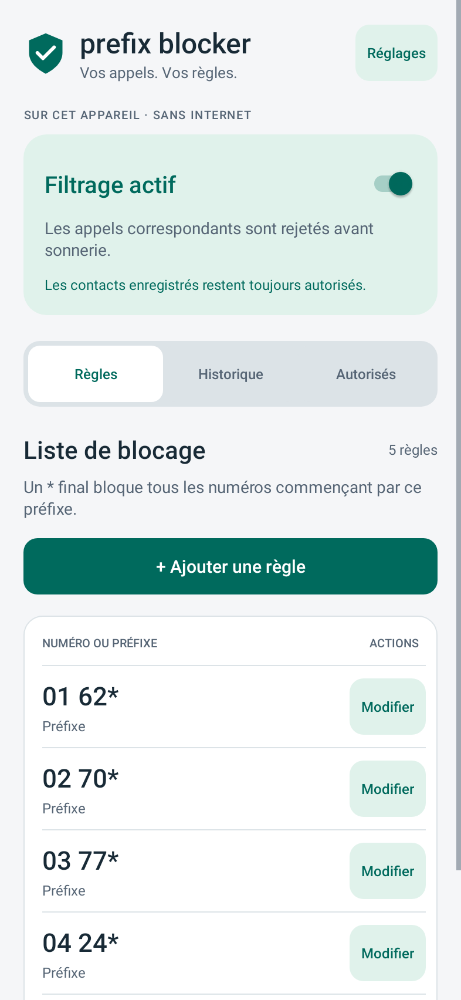
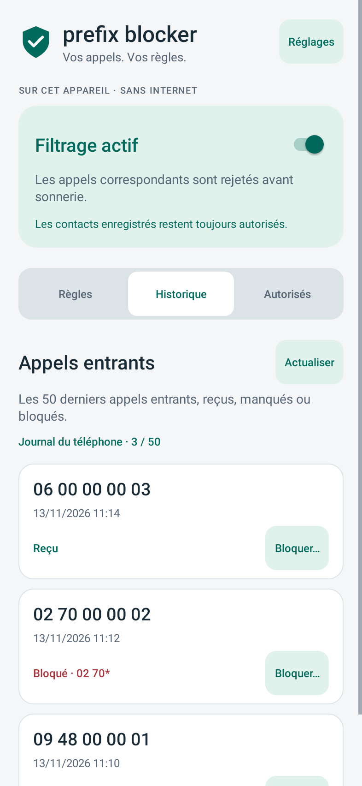
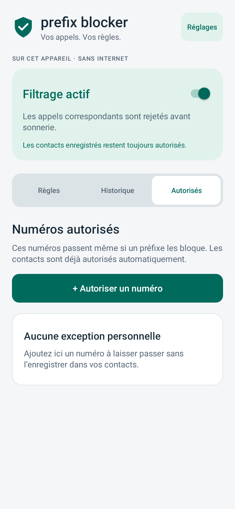

# prefix blocker

Une application Android en Kotlin pour rejeter les appels entrants à partir d’une liste de préfixes ou de numéros. Interface en français, thèmes clair et sombre, fonctionnement entièrement local.

**Android 10 minimum.** La première campagne de tests sur téléphone vise un CUBOT P60 sous Android 12.

## Installer la version 1

Télécharger **`prefix-blocker-v1.0.0.apk`** depuis les [versions GitHub](https://github.com/ryosama/android-prefix-blocker/releases/latest).

### Directement sur le téléphone

1. Ouvrir l’APK téléchargé depuis le navigateur ou l’application Fichiers.
2. Si Android le demande, autoriser temporairement cette application à installer des applications inconnues.
3. Installer puis ouvrir **prefix blocker**.
4. Appuyer sur **Choisir prefix blocker**, sélectionner l’application et valider le rôle de filtrage des appels / identification de l’appelant.
5. Dans **Réglages**, autoriser la lecture du journal d’appels pour afficher l’historique complet. L’accès aux contacts est facultatif.

### Depuis un ordinateur, par USB

Installer les [Android Platform Tools](https://developer.android.com/tools/releases/platform-tools). Activer le débogage USB, brancher le téléphone et accepter son message d’autorisation.

Depuis ce répertoire, avec l’APK dans `dist/` :

```bash
./scripts/install.sh
```

Ou, pour un APK téléchargé ailleurs :

```bash
./scripts/install.sh /chemin/vers/prefix-blocker-v1.0.0.apk
```

Le script installe l’application et l’ouvre. Les autorisations et le choix du service se font ensuite sur le téléphone. `adb install -r` conserve les données lors des mises à jour signées avec la même clé.

## Utilisation

- **Règles** : ajouter, modifier ou supprimer un préfixe ou un numéro exact, une entrée par ligne.
- **Historique** : consulter les 50 derniers appels entrants, y compris les manqués, rejetés et bloqués ; utiliser **Bloquer…** pour ajouter le numéro, puis l’éditer éventuellement en préfixe. Le même menu permet de l’autoriser.
- **Autorisés** : définir des exceptions exactes qui passent même si un préfixe les bloque.
- **Interrupteur** : suspendre ou reprendre immédiatement le filtrage, sans supprimer les règles.
- **Réglages → Tester un numéro** : vérifier les règles sans passer d’appel. Cette simulation ne remplace pas un essai téléphonique réel.

Les contacts enregistrés sont toujours autorisés. Les exceptions explicites ont également priorité sur les règles de blocage. Lorsqu’aucune règle ne correspond, l’appel passe.

| Entrée | Effet |
| --- | --- |
| `0948*`, `09 48*`, `+33948*`, `0033948*` | Même préfixe français : tous les numéros commençant par 0948 |
| `09 48 00 00 01` ou `+33948000001` | Un seul numéro exact |
| `+4420*` ou `004420*` | Préfixe international |

Les espaces, tirets, points et parenthèses sont ignorés. Un numéro national est interprété comme français. `*` est accepté uniquement à la fin d’une règle de blocage ; les exceptions demandent un numéro complet. Les doublons équivalents sont refusés. Une règle plus courte peut couvrir une grande quantité de numéros : la fenêtre d’édition affiche son effet avant l’enregistrement.

Les cinq règles initiales sont : **0948\***, **0270\***, **0424\***, **0162\*** et **0377\***. Elles sont ajoutées uniquement à la première création de la base ; une règle supprimée ne revient pas au redémarrage.

## Aperçu

Rendus de l’interface Android 12 générés avec Robolectric. Toutes les données affichées sont fictives ; aucune capture du téléphone personnel n’est utilisée.

| Règles | Historique | Exceptions |
| --- | --- | --- |
|  |  |  |

Autres aperçus : [édition d’une règle](docs/screenshots/edit-rule.png), [thème sombre](docs/screenshots/rules-dark.png).

## Historique et autorisations

L’application utilise [`CallScreeningService`](https://developer.android.com/reference/android/telecom/CallScreeningService) et le rôle Android de filtrage. Elle ne remplace pas le composeur ni l’application Téléphone.

| Accès | Utilité | Si l’accès est refusé |
| --- | --- | --- |
| Rôle de filtrage | Autoriser/rejeter les appels avant sonnerie | Aucun blocage par prefix blocker ; les règles restent éditables |
| Lecture du journal (`READ_CALL_LOG`) | Lire les 50 derniers appels entrants, même avant l’installation | Historique local des 50 dernières décisions du filtre, explicitement signalé |
| Lecture des contacts (`READ_CONTACTS`), facultative | Vérifier qu’un numéro correspond à un contact ; afficher les noms présents dans le journal | Android exclut les appels des contacts du service de filtrage |

L’[autorisation de lecture du journal](https://developer.android.com/reference/android/Manifest.permission#READ_CALL_LOG) est restreinte par Android et dépend de l’installateur. Si elle n’est pas accessible après une installation manuelle, réinstaller le même APK avec `adb install -r`, puis réessayer dans les réglages. Éviter `--restrict-permissions`. L’application reste utilisable avec son historique local.

Un appel observé puis autorisé par le filtre n’est pas nécessairement un appel décroché : l’historique local affiche **Autorisé par le filtre**. Lorsque le journal système est accessible, il fournit les états reçus/manqués/rejetés/bloqués. La règle de blocage est affichée quand une décision locale correspondante est disponible ; un ancien appel bloqué par le téléphone n’est pas attribué à une règle actuelle.

### CUBOT / MediaTek : vérifier DuraSpeed

Sur les appareils équipés de DuraSpeed, dont le CUBOT P60 sous Android 12, ouvrir **Paramètres → DuraSpeed** et activer l’interrupteur de **prefix blocker** dans la liste des applications autorisées en arrière-plan. Cette exception est distincte du réglage de batterie Android : autoriser l’utilisation de batterie sans restriction ne suffit pas à configurer DuraSpeed.

Lors du diagnostic sur le téléphone de test, Android a laissé passer un appel après expiration du délai de filtrage, sans connexion au service de l’application. Le service répondait normalement lors des essais suivants, y compris après arrêt de son processus. DuraSpeed était activé et l’exception de prefix blocker était désactivée ; elle a été ajoutée. Ce constat justifie de vérifier ce réglage, sans attribuer tous les délais de filtrage à DuraSpeed.

Pour tester un rejet réel, utiliser un numéro absent des contacts et des exceptions, avec une règle correspondant à ce numéro. Un contact doit continuer à sonner, même s’il correspond à une règle de blocage.

## Confidentialité

- Aucune permission Internet, aucun serveur, compte, publicité, outil d’analyse ou télémétrie.
- Règles, exceptions et 50 dernières décisions conservées dans le stockage privé de l’application.
- Pas de sauvegarde automatique dans le cloud ni de transfert automatique de ces données.
- Les journaux techniques de l’application ne contiennent pas les numéros de téléphone.
- **Effacer l’historique local** supprime uniquement les décisions stockées par l’application, sans modifier le journal du téléphone.
- Les clés de signature, mots de passe, chemins locaux, caches et fichiers de compilation sont exclus de Git.

## Limites

- Les appels masqués, inconnus ou sans numéro exploitable ne peuvent pas être bloqués par préfixe. Android ne transmet pas ces appels au service dans plusieurs situations.
- Le service concerne les appels téléphoniques transmis par Android, pas les appels WhatsApp, Signal ou autres messageries.
- Un rejet peut conduire au répondeur selon le téléphone et l’opérateur ; l’application ne commande pas la messagerie de l’opérateur.
- Les particularités constructeur et le fonctionnement avec plusieurs SIM doivent être vérifiés sur les appareils concernés.
- En cas d’erreur ou de vérification trop lente, l’application laisse passer l’appel. Une réponse de secours intervient après 3 secondes, avant la limite Android de 5 secondes.
- Le filtrage porte sur le numéro présenté par le réseau ; l’application ne peut pas garantir l’identité réelle de l’appelant.

## Développement

Prérequis : **JDK 17**, SDK Android avec **platforms;android-35** et **build-tools;35.0.0**. Définir `ANDROID_HOME`, ou créer un fichier `local.properties` contenant `sdk.dir=/chemin/du/sdk` (ignoré par Git).

```bash
./gradlew testDebugUnitTest lintDebug assembleDebug
```

Le projet utilise Gradle 8.11.1, Android Gradle Plugin 8.9.2 et Kotlin 2.1.20. L’interface repose sur les vues Android natives, le stockage sur SQLite et SharedPreferences. Aucun service permanent ni permission d’accessibilité n’est nécessaire.

Les tests vérifient la normalisation des numéros, les priorités de filtrage, le service Android, la persistance, la rétention de 50 décisions, la lecture du journal, les autorisations refusées et les principales interactions de l’interface sous Android 12 simulé.

Validation de la v1 : **49 tests réussis**, analyse Android sans problème en debug et release. Voir le [compte rendu](docs/VALIDATION-v1.md) et le [protocole d’essai sur téléphone](docs/TEST-SMARTPHONE.md).

Pour régénérer les captures avec des données fictives :

```bash
./gradlew testDebugUnitTest -PscreenshotsDir="$PWD/docs/screenshots" --rerun-tasks
```

### APK signé

```bash
python3 scripts/create-release-key.py
./gradlew assembleRelease
```

La première commande crée une clé au nom générique **Prefix Blocker** dans `.private/`. Elle refuse d’écraser une clé existante. Garder une copie privée de **tout ce dossier** pour pouvoir signer les mises à jour avec la même identité. Ne jamais le publier. Sans configuration de signature locale, Gradle produit un APK release non signé.

L’APK signé est généré dans `app/build/outputs/apk/release/app-release.apk`. La distribution publique se fait par les versions GitHub, sans publication sur un magasin d’applications.

Avant publication, après ajout des fichiers publics à l’index Git :

```bash
python3 scripts/check-public-artifacts.py app/build/outputs/apk/release/app-release.apk
```

Ce contrôle recherche les identifiants locaux courants dans les fichiers suivis et le contenu décompressé de l’APK. Des chaînes privées supplémentaires peuvent être ajoutées, une par ligne, dans `.private/privacy-patterns.txt`, lui aussi exclu de Git. Ce contrôle complète la revue des fichiers destinés à être publiés.

## Licence

Aucune licence de réutilisation n’est accordée pour le code du projet. Les composants tiers conservent leurs licences respectives ; les mentions du runtime Kotlin distribué figurent dans l’APK.
